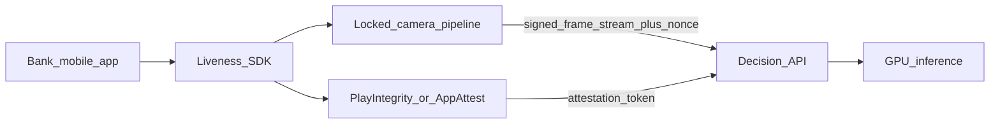

# Native SDK & device attestation (Phase 3)

This document is the bank-grade path when **exact-device camera capture** must be proven.
The current mobile web + API stack can match detection quality, but **cannot** cryptographically
prove frames came from a given phone’s camera.

## Why web is not enough for “exact device”

| Attack | Web frontend + API | Hardened native SDK |
|--------|--------------------|---------------------|
| Virtual camera / OBS | Easy | Hard (camera HAL binding) |
| Browser DevTools frame inject | Easy | N/A |
| Upload pre-recorded file | Easy if `/verify` open | Blocked (no file path) |
| Proxy / MITM rewrite | Possible without pinning | Mitigated with cert pinning + signed frames |
| Emulator / rooted device | Soft signals only | Play Integrity / App Attest |

Server-side PAD (spatial / temporal / screen-replay) still runs in both models.
SDK adds **capture authenticity**, not a replacement for liveness models.

## Target architecture

## Recommended build order

1. **Android first** (higher fraud volume): Kotlin module or AAR consumed by the bank app.
2. **iOS second**: Swift package with App Attest + Secure Enclave signing.
3. Optional **hybrid**: keep React UI in WebView; only the capture loop is native.

## SDK responsibilities

1. Create session with bank JWT → receive `session_id` + `nonce` (already on Decision API).
2. Open camera via platform APIs only (no file picker / gallery).
3. Request device attestation (Play Integrity / App Attest) bound to `nonce`.
4. Stream JPEG/YUV frames with:
   - `nonce`
   - monotonic `ts`
   - HMAC or asymmetric signature over `(session_id, frame_index, ts, sha256(frame))`
5. Prefer the existing `/ws/live` protocol; extend with `attestation` + `frame_sig` fields.
6. Never expose a “upload arbitrary video” path for high-value amounts.

## Decision API changes (when SDK ships)

- New fields on WS `start`: `attestation_token`, `sdk_version`, `platform`.
- Verify attestation with Google/Apple before accepting frames.
- Verify per-frame signatures; reject on break in chain or nonce mismatch.
- Keep `ALLOW_VERIFY_UPLOAD=false` and `HIGH_VALUE_REQUIRE_LIVE_WS=true`.
- Private network + mTLS between Decision API and GPU server.

## Compliance evidence pack

- Document FAR at target FRR from [`scripts/pilot_metrics.py`](../scripts/pilot_metrics.py).
- Independent red-team: print attack, PC playback, deepfake video, virtual cam.
- Retain audit rows (`reason_codes`, `capture_trust=sdk`) for each high-value decision.

## Interim (until SDK)

- Use hardened web pilot: API key, nonce, TTL, HTTPS, fail-closed face match.
- Treat web `capture_trust=live_ws` as **soft trust**; escalate high-value transfers to branch / OTP / delay until SDK is live.
